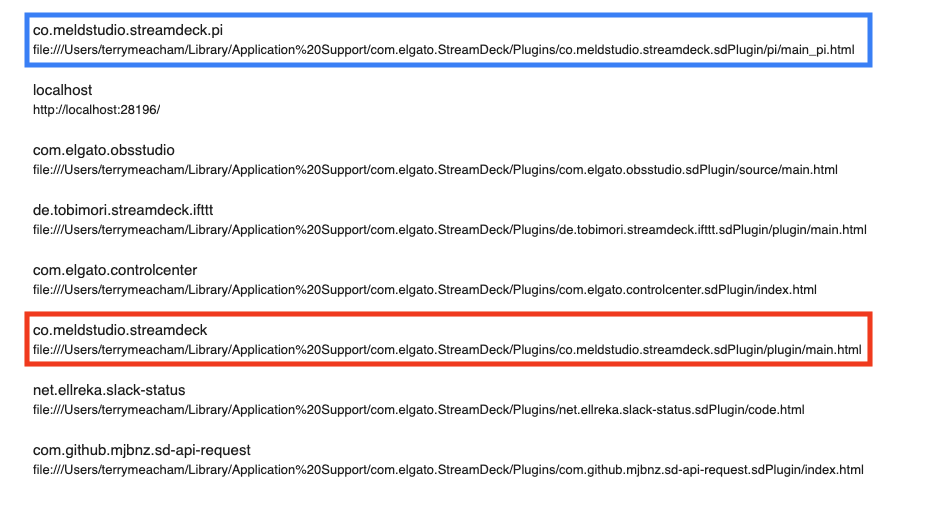
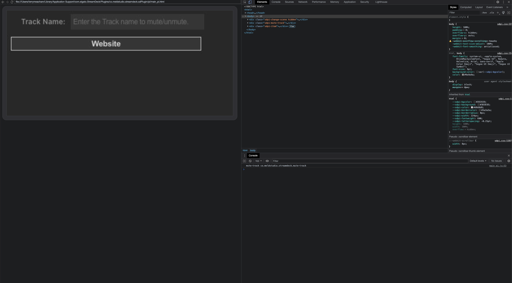

# Meld Studio - Stream Deck Plugin

To download the current official release, visit our page on the [Elgato marketplace](https://marketplace.elgato.com/product/meld-studio-737415fa-1957-489d-a62e-1becec068b6e).

## Integrations

If you're interested in developing a software intergration with Meld Studio, you can find our API documentation [here](./WebChannelAPI.md). If you have any questions, please join our [discord](https://discord.gg/ZHpeXEw4) and reach out in [`#support`](https://discord.com/channels/1019227275897614337/1019584582913364101).

## Architecture

The plugin is built on Elgato's official [Node.js Stream Deck SDK](https://docs.elgato.com/streamdeck/sdk/introduction/getting-started/) (`@elgato/streamdeck`). It runs as a single long-lived Node process, so there is exactly **one** connection to Meld Studio for the whole plugin, shared by every action and every property inspector.

- `src/plugin.ts` — entry point; registers the 14 actions and starts the Meld connection.
- `src/meld/` — the Meld service layer: a single QWebChannel-over-WebSocket connection (`connection.ts`) with automatic reconnect and a track-observer registry, a typed session model (`session.ts` / `types.ts`), and typed events (`events.ts`).
- `src/actions/` — one file per action, all extending `MeldAction` (`base.ts`), which turns Meld/session/reconnect events into a single declarative `render()` call.
- `src/ui-bridge.ts` — answers property-inspector requests for session data from the one connection; the inspectors under `co.meldstudio.streamdeck.sdPlugin/ui/` never talk to Meld directly.

The build (`rollup`) bundles `src/plugin.ts` into `co.meldstudio.streamdeck.sdPlugin/bin/plugin.js`.

Requires Stream Deck **7.1+** and bundles the **Node 24** runtime (see `manifest.json`).

## Development

We primarily develop on macOS, so these instructions are tailored to macOS. Feel free to submit a PR to update them for Windows if that's your flavor of OS.

1) Check out the repository and run `npm install`.
2) Run `scripts/install.sh` (optionally, `--fresh` to remove and reinstall).

   This builds the plugin (`npm run build`) and syncs it into
   `~/Library/Application\ Support/com.elgato.StreamDeck/Plugins/`.

3) Code away. Type-check with `npm run typecheck`.
4) Run `scripts/install.sh` again to rebuild and update the install, or use
   `npm run watch` to rebuild on save and restart the plugin automatically.

   See below for debugging information.

## Debugging:

The plugin runs in Node, so it is debugged as a Node process, while property inspectors remain web pages.

- **Plugin (Node):** the manifest enables the Node inspector (`"Nodejs": { "Debug": "enabled" }`). Attach a debugger / open `chrome://inspect` in Chrome to connect to the plugin process. Logs are written to `co.meldstudio.streamdeck.sdPlugin/logs/`.
- **Property inspectors (web):** run `defaults write com.elgato.StreamDeck html_remote_debugging_enabled -bool YES` and restart the Stream Deck app, then navigate to `http://localhost:23654/` in Chrome to inspect the inspector pages.





## Packaging

Elgato provides a CLI packaging tool.

[https://docs.elgato.com/sdk/plugins/packaging]

```
$ npm install
$ npm run build
$ npx streamdeck validate co.meldstudio.streamdeck.sdPlugin
$ npx streamdeck pack co.meldstudio.streamdeck.sdPlugin
```

Or simply `npm run pack`, which builds and packs in one step.

This outputs a file `co.meldstudio.streamdeck.streamDeckPlugin` which can be installed directly.
